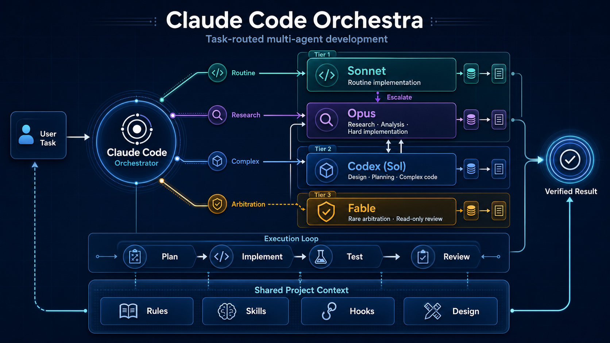

[English](README.md) | [日本語](README.ja.md)

# claude-code-orchestra



マルチエージェント AI 開発環境

```
Claude Code（オーケストレーター）─┬─ Sonnet サブエージェント（定型的な実装）
                                  ├─ Opus サブエージェント（調査・分析・難度の高い実装）
                                  └─ Codex CLI（計画・複雑なコード）
```

## クイックスタート

まず、2 つの AI CLI がインストールされ、認証済みであることを確認します。

```bash
claude --version && codex --version
```

### 新規プロジェクト

GitHub の **Use this template** ボタンでリポジトリを作成してクローンし、次を実行します。

```bash
claude
```

Claude Code 内で `/init` を実行すると、プロジェクトの技術スタックを検出し、プロジェクトの
identity と設計ドキュメントが作成されます。

### 既存プロジェクト

既存の Git リポジトリのルートで次を実行します。

```bash
template_dir="$(mktemp -d)"
git clone --depth 1 https://github.com/Yuulis/claude-code-orchestra.git "$template_dir"
bash "$template_dir/scripts/install.sh" . && rm -rf "$template_dir"
```

インストーラーは、`README.md`、`VERSION`、既存の `AGENTS.md` / `CLAUDE.md` の内容など、
プロジェクト側のファイルを保持します。マージ後の内容は `.claude/STATE.md` に配置され、
ルートの `AGENTS.md` 契約がインストールされます。既存の `CLAUDE.md` は
`CLAUDE.md.pre-agents-md.bak` に退避されます。`CLAUDE.md` があると Claude Code は
`AGENTS.md` を読み込まないためです。テンプレート側が管理するパスと衝突した場合は、
変更を加える前にインストールが停止します。報告されたパスを確認したうえで `--force` を
指定すると、それらを `.orchestra-backup-*/` にバックアップして置き換えます。

既存の `.claude/settings.json` が上書きされることはありません。手動でのマージが必要な場合、
インストーラーは `.claude/settings.orchestra.json` を書き出します。必要な設定をマージし、
この候補ファイルを削除してから Claude Code を起動してください。

その後、Claude Code を起動して `/init` を実行します。

```bash
claude
```

## 前提ツール

### Claude Code

```bash
npm install -g @anthropic-ai/claude-code
claude login
```

### Codex CLI

```bash
npm install -g @openai/codex
codex login
```

### システムツール

インストーラーとアップデーターには `git` と標準的な Unix シェルツールが必要です。
テンプレートの更新には、さらに `rsync` が必要です。

### Codex Plugin for Claude Code（任意）

Claude Code から Codex を直接使えるプラグインです。コードレビューやタスクの委譲が簡単になります。

```bash
# Claude Code 内で実行
/plugin marketplace add openai/codex-plugin-cc
/plugin install codex@openai-codex
/reload-plugins
/codex:setup
```

**利用できるコマンド：**
- `/codex:review` — コードレビュー
- `/codex:adversarial-review` — 設計に異議を唱えるレビュー
- `/codex:rescue` — タスクの委譲
- `/codex:status` / `/codex:result` / `/codex:cancel` — ジョブ管理

### AI CLI を最新に保つ

Claude Code と Codex CLI はどちらもリリース頻度が高く、マイナーバージョンの間でもモデル名・フラグ・sandbox の挙動が変わります。**作業セッションの前に両方を更新してください。**

```bash
# Claude Code（組み込みのセルフアップデート）
claude update

# Codex CLI
npm install -g @openai/codex@latest
```

更新後にバージョンを確認します。

```bash
claude --version && codex --version
```

Codex のモデルは `.claude/settings.json`（`env.CODEX_MODEL`）に一元化されており、すべての `${CODEX_MODEL:-...}` 参照はこの値に解決されます。`.codex/config.toml`（`model` と `model_reasoning_effort`）も同じ内容に揃えておく必要があり、両者の整合性は `scripts/check.sh` が検証します。常に最新のモデルを使いたい場合は、この 1 か所の値（現在は `gpt-6.1-sol`）を書き換えるだけで済み、個別のスキルファイルを編集する必要はありません。`${CODEX_MODEL:-...}` のフォールバックは、環境変数が未設定のときの既定値にすぎません。なお、`update.sh` は `.claude/settings.json` を自動でマージしないため、利用者は Phase 5 の diff を確認したうえで `env.CODEX_MODEL` を手動で更新してください。

Claude サブエージェントのルーティングは `.claude/agents/` に明示されています。
`general-purpose-sonnet` と `general-purpose-opus` は、frontmatter で自身のモデルエイリアスを固定します。
指定のないサブエージェントは、`.claude/settings.json`（`env.CLAUDE_CODE_SUBAGENT_MODEL`）により
Sonnet がデフォルトになります。

ほかの CLI エージェントへは `.claude/skills/_shared/cli_consult.py` を通じて問い合わせます。
Claude Code（`--cli claude`）と Antigravity（`--cli antigravity`、ヘッドレスの `agy -p`）に
対応しています。Gemini CLI のサポートは削除されました。

## アーキテクチャ

規範となるオーケストレーション方針、エージェントとスキルの全体像、すべてのランタイムが自動で読み込む
CLI エージェント契約は、すべてルートの `AGENTS.md` にあります。
`.claude/rules/tiers.md` には、安定したティアの詳細をまとめています。
初期のメインエージェントは Claude Code です。Codex や Antigravity など別のランタイムへ昇格するようユーザーが
求めた場合は、`.claude/docs/change_main.md` に従ってください。下の図は、デフォルト構成の
規範ではない概要図です。

```
┌─────────────────────────────────────────────────────────────┐
│     Claude Code（オーケストレーター — Opus, 1M コンテキスト）  │
│     → コンテキストの温存が最優先                              │
│     → ユーザー対話、調整、簡潔な編集を担当                    │
│                          │                                  │
│  ┌───────────────────────┼──────────────────────────────┐   │
│  │  Tier 1 — デフォルト   │                              │   │
│  │  ┌────────────────────┴─────────────────────────┐    │   │
│  │  │ general-purpose-sonnet: 定型的な実装          │    │   │
│  │  │ general-purpose-opus: 調査 / 難度の高い実装   │    │   │
│  │  │ codex-debugger: エラー分析                    │    │   │
│  │  └──────────────────────────────────────────────┘    │   │
│  │                       │                              │   │
│  │  ┌────────────────────┴─────────────────────────┐    │   │
│  │  │ Tier 2 — Sol                                 │    │   │
│  │  │ Codex CLI  (gpt-6.1-sol, effort high)        │    │   │
│  │  │ → 設計・計画・複雑なコード・デバッグ          │    │   │
│  │  └──────────────────────────────────────────────┘    │   │
│  │                       │                              │   │
│  │  ┌────────────────────┴─────────────────────────┐    │   │
│  │  │ Tier 3 — Fable（まれに使う上位の判断役）      │    │   │
│  │  │ → 調停・行き詰まった問題・最終レビュー        │    │   │
│  │  │ → 解決まで担当可。記録は reviews/ に残す      │    │   │
│  │  └──────────────────────────────────────────────┘    │   │
│  └──────────────────────────────────────────────────────┘   │
└─────────────────────────────────────────────────────────────┘
```

### コンテキスト管理（重要）

`AGENTS.md` のルーティング方針と実行パターンに従ってください。
製品固有の委譲の仕組みは、引き続き `.claude/rules/` と、対応する正規のエージェント定義・スキル定義に置かれています。

基本姿勢は**委譲優先**です。`.claude/rules/delegation.md` は、メインエージェントによる直接実行を
例外とし、閉じた Self-Handle List に載っているものだけに限定しています。また、すべてのスキルが
従うトリガー、ルート表、サブエージェントへのプロンプト契約も定めています。委譲で動くのは作業であって
責任ではありません。受け入れチェックの実行と diff の確認は、引き続き呼び出し側が行います。

## ディレクトリ構成

`.claude/` は、エージェントランタイムの実体（物理的な正本）です。ルール、スキル、エージェント定義、
フック、プロジェクトのドキュメント、状態がここにあります。`.agents/`（Antigravity）と
`.codex/`（Codex）はそれぞれのランタイム固有のディレクトリで、置くのはそのランタイムの
エントリー契約ただ 1 つです。共有ドキュメントはすべて `.claude/` 配下にあり、コピーせずパスで
参照します。このレイアウトにシンボリックリンクを介して到達するものはありません。

```
.
├── AGENTS.md                    # 単一のルート契約。全ランタイムが自動で読み込む: メインエージェントの使命、ルーティング、カタログ、ゲート、CLI 実行側のルール
├── README.md
├── README.ja.md                 # README.md の日本語版
├── PROGRESS.md                  # 初回の /checkpointing 実行時に生成。直近 5 件の要約
├── LICENSE
├── pyproject.toml               # Python プロジェクト設定
├── uv.lock                      # 依存関係のロックファイル
├── VERSION                      # このテンプレートリポジトリのバージョン。利用先のプロジェクトでは置き換えてよい
│
├── .claude/                     # メインエージェントのランタイム（物理的な正本）
│   ├── settings.json            # Claude Code 設定。hooks は .claude/hooks/ を指す
│   ├── orchestra-version        # 利用先プロジェクトにインストール済みの Orchestra バージョン
│   ├── STATE.md                 # メインエージェント、リポジトリ identity、作業状態
│   ├── agents/                  # サブエージェント定義。Claude Code が自動で検出する
│   ├── skills/                  # ワークフロースキルと決定的なヘルパー
│   │   └── _shared/             # 同梱ランタイム: どのスキルも依存してよいヘルパー
│   ├── hooks/                   # フックの実装
│   ├── rules/                   # 方針: 委譲、ティア、CLI、コーディング、テスト、セキュリティ、状態
│   ├── docs/                    # INDEX.md の台帳、change_main.md の手順書、設計、調査、レビュー
│   ├── logs/                    # 実行時ログ（git 管理外）
│   └── checkpoints/             # セッションのチェックポイント（git 管理外）
│
├── docs/
│   └── manual/                  # 仕様書・実装状況の日本語まとめ（テーマごとのディレクトリ。.claude/rules/manual-docs.md）
│
├── .agents/                     # Antigravity 固有のディレクトリ
│   └── AGENTS.md                # Antigravity 用アダプター: ヘッドレスでの挙動と制限
│
├── .codex/                      # Codex 固有のディレクトリ
│   ├── AGENTS.md                # Codex 用アダプター: モデル設定、sandbox の規律、有効なスキル
│   └── config.toml              # ネイティブ設定（上書きされない）。スキルは .claude/skills/ を指す
│
├── tests/                       # テンプレート自身のスクリプトとドキュメントの契約テスト
│
└── scripts/
    ├── check.sh                # 契約・ブートストラップ・モデル・ティアの整合性チェッカー
    ├── install.sh              # 既存プロジェクト向けの、衝突を考慮したインストーラー
    └── update.sh               # テンプレート更新スクリプト
```

すべての CLI ランタイムはルートの `AGENTS.md` を自動で読み込みます。このファイルは自己完結しており、
応答の構成、ハンドオフのルール、別の CLI をサブエージェントとして呼び出す方法、完了検証のガードレールが
すべて、読み込まれるファイルの中に書かれています。そのうえで各ランタイムは、自分固有の事柄についてだけ
短いアダプター（`.codex/AGENTS.md`、`.agents/AGENTS.md`）を読みます。`CLAUDE.md` は存在しません。
Claude Code は `AGENTS.md` が見つからない場合にだけ `CLAUDE.md` を読むためです。委譲された実行が依存する情報が、
ポインタの向こう側に隠れていることはありません。

### Codex 連携の安定化

- Codex への依頼は、`@.claude/docs/CODEX_HANDOFF_PLAYBOOK.md` のテンプレートで標準化する
- `.claude/rules/codex-delegation.md` が「Codex 優先の委譲」方針と例外条件を定義する
- `.codex/config.toml` は、非対話フローでブロックされないよう `approval_policy = "never"` を、制限なしで実行できるよう `sandbox_mode = "danger-full-access"` を採用している
- 共有ラッパーも、包んでいる CLI より黙って厳しくなることなく、同じ無制限のアクセスをデフォルトにしている。そのため、エージェントが触れる範囲はどの経路で呼ばれたかに左右されない。計画やレビューの呼び出しでは、`--sandbox read-only`（Codex）と `--read-only`（`cli_consult.py`）を明示的に選択できる
- 委譲された実行を制限するものは何もないため、ラッパーの呼び出しはすべて `.claude/skills/_shared/edit_provenance.py` で挟まれ、作成・変更・削除されたファイルが `caller` と `label` とともに `.claude/logs/cli-tools.jsonl` に記録される。「どのサブエージェントがこれを変更したのか」は、このログで答えられる

## ワークフロー

メインのワークフローでは、2 つのスキルを順に実行します。

```
/feature <機能>      計画: モード判定 → 理解 → 調査・設計 → 計画
    ↓ ユーザー承認後（COMPLEX ルート）
/team-execute        Phase 1: 並列実装 → Phase 2: 並列レビュー（Agent Teams）
```

1. **モード判定**: existing（Codex に直接相談して設計）か greenfield（Agent Teams で調査・設計）か
2. **Opus サブエージェント**がコードベースを分析（1M コンテキスト）し、**Claude** がユーザーと要件を詰める
3. existing モード: **Codex** が設計・計画・検証を行う。greenfield モード: **Agent Teams** — Researcher（Opus）と Architect（Codex）が並列で作業する
4. **Claude** が調査と設計を統合し、計画をユーザーに提示する
5. 承認後、`/team-execute` がモジュール単位で並列に実装し、続けてセキュリティ・品質・テストの観点で並列にレビューする（`--review-only` を付けると実装をスキップする）

## スキル

各スキルは、エージェントが従う手順を書いた `SKILL.md` です。入力に対して正解の出力がひとつに決まる
ステップ（成果物パスの導出、ドキュメント構造の検証、Codex CLI の呼び出し、品質ゲートの実行など）は、
文章で説明する代わりに同梱のスクリプトへ任せています。これにより、フェーズ間でずれたり、気づかれないまま
失敗したりすることがありません。判断を要するステップは markdown に残します。この境界と、スクリプト共通の契約
（stdout に JSON オブジェクトを 1 つ出力する、共通の終了コード体系を使う、エラーを握りつぶさない）は
`.claude/skills/_shared/README.md` に記載されています。

### コアワークフロー

#### `/feature` — 機能の計画と実装（統合版）

機能開発の単一の入口で、2 つのモードがあります（旧 `/add-feature` と `/start-feature` を統合したものです）。

```
/feature ユーザープロフィール編集機能
```

**モード：**
- **existing**（旧 `/add-feature`）— Codex 優先で既存のコードベースに機能を追加します。Opus サブエージェントと Codex がスコープと影響範囲を分析し、そのあと Codex がアーキテクチャ設計、実装計画、検証を行います
- **greenfield**（旧 `/start-feature`）— 外部調査が必要な大規模・新規の機能向けです。Opus サブエージェントがコードベースを分析した後、Agent Teams（Researcher [Opus] と Architect [Codex]）が並列で調査・設計を行います

**共通の複雑度ベースのルーティング：**
- SIMPLE（1〜3 ファイル、50 LOC 未満）→ Codex が直接実装
- MODERATE（3〜5 ファイル）→ Codex が実装 + `/team-execute --review-only`
- COMPLEX（5 ファイル以上）→ `/team-execute`

#### `/team-execute` — 並列実装 + レビュー（統合版）

Agent Teams による 2 フェーズの実行です（旧 `/team-implement` と `/team-review` を統合したものです）。`/feature` で承認された計画に基づいて実行します。

```
/team-execute                 # Phase 1 IMPLEMENT → Phase 2 REVIEW
/team-execute --review-only   # Phase 1 をスキップし、既存の変更をレビュー
```

**Phase 1 IMPLEMENT：**
- モジュール／レイヤーごとに Teammate を起動し、ファイルの所有権を分離する
- 共有タスクリストで依存関係を管理し、自律的に連携させる
- 各 Teammate は完了時に、作業ログを `.claude/logs/agent-teams/` に記録する

**Phase 2 REVIEW（レビュアー構成）：**
- **Security Reviewer** — セキュリティ上の脆弱性を検出する
- **Quality Reviewer** — コード品質とパターンへの準拠を確認する（Codex を活用）
- **Test Reviewer** — テストのカバレッジと品質を検証する

#### `/spike` — 技術調査・実現可能性の検証

Codex 優先でタイムボックスを設けた技術調査です。go/no-go の推奨を含む**意思決定ドキュメント**を作成します。出力は実装計画ではなく、意思決定のための材料です。

```
/spike WebSocket と SSE のどちらを採用すべきか？
```

**ワークフロー：**
1. **Claude + Codex** → 調査すべき問いを整理し、制約を定める
2. **Agent Teams** → Researcher（Opus による外部調査）と Feasibility Analyst（Codex による深掘り分析）が並列で調査する
3. **Codex** → go/no-go の推奨にまとめ、調査レポートを作成する

> GO と判断したら、`/feature` で実装に進みます

### 開発

#### `/plan` — 実装計画

要件を具体的なステップに分解します。

```
/plan API エンドポイントを追加する
```

**出力：**
- 実装ステップ（ファイル、変更内容、検証方法）
- 依存関係とリスク
- 検証基準

#### `/tdd` — テスト駆動開発

Red-Green-Refactor のサイクルで実装します。

```
/tdd ユーザー登録機能
```

**ワークフロー：**
1. テストケースの設計
2. 失敗するテストを書く（Red）
3. 最小限の実装（Green）
4. リファクタリング（Refactor）

#### `/simplify` — コードのリファクタリング

コードを簡潔にし、読みやすくします。

#### `/troubleshoot` — エラー診断と修正計画

Codex を中心としたマルチエージェントの連携で、エラーを診断し、修正計画を作成します。

```
/troubleshoot TypeError: cannot unpack non-iterable NoneType object
```

**ワークフロー：**
1. **Opus サブエージェント + Codex** → エラーを再現し、コンテキストを集める
2. **Agent Teams** → Root Cause Analyst（Codex 主導）と Impact Investigator（Opus + Codex）が並列で診断する
3. **Claude + Codex** → 修正計画を統合し、ユーザーの承認を得る

### エージェントへの委譲

#### `/codex-system` — Codex CLI 連携

設計判断、デバッグ、トレードオフの分析に使います。

**トリガーの例：**
- 「これはどう設計すべき？」「どう実装すればいい？」
- 「なぜ動かないの？」「エラーが出る」
- 「どちらがいい？」「これらの選択肢を比較して」

#### `/antigravity-system` — Antigravity CLI 連携（このフォークで追加）

Antigravity（`agy`）によるクロスモデルのセカンドオピニオンです。詳細は[フォーク独自の追加内容](#フォーク独自の追加内容)を参照してください。

### ドキュメント

#### `/design-tracker` — 設計判断の追跡

会話の中で設計判断を検出し、`.claude/docs/DESIGN.md` の該当セクション（機能要件 / 非機能要件 / アーキテクチャ / 技術選定 / 制約 / Key Decisions）を構造的に更新します。自発的に起動するほか、「これを記録して」「DESIGN を更新して」といった明示的な依頼でも動作します。

#### `/research-lib` — ライブラリ調査

ライブラリを調査し、網羅的なドキュメントを `.claude/docs/libraries/` に生成します。

```
/research-lib httpx
```

#### `/update-lib-docs` — ライブラリドキュメントの更新

`.claude/docs/libraries/` にある既存のドキュメントを、最新の情報で更新します。

### セッション管理

#### `/checkpointing` — セッションの永続化

セッションの活動を `.claude/checkpoints/` に記録し、ローリング形式の `PROGRESS.md` を再生成します。また、
`.claude/STATE.md` 内の古くなった作業ブロックを圧縮し、メインエージェントの選択、リポジトリ identity、
進捗へのリンクは保持します。

```bash
/checkpointing                    # 完全な記録 + パターン発見
/checkpointing --since "2026-02-08"  # 特定の日付以降のみ
/checkpointing --compact-only    # Compact フェーズのみ実行（旧 /context-refresh）
```

#### `/init` — プロジェクトの初期化

プロジェクト構造を分析し、技術スタック、コマンド、設定を自動検出します。`.claude/docs/DESIGN.md` を作成し、
`.claude/STATE.md` では、薄い `## Repository Identity` セクションだけを更新します。

#### `/catchup` — オンボーディングガイド

リポジトリ（git 履歴、AGENTS.md、プロジェクトのルール、スキルカタログ、DESIGN.md、調査・ライブラリのノート、チェックポイント、agent-team のログ）をスキャンし、リポジトリのルートに `GUIDE.md` を書き出します。新しく参加した人や復帰した人が、過去の作業を把握してすぐに作業を再開できます。

```bash
/catchup
```

## 開発

### テンプレートの更新

テンプレートの更新を、ローカルのプロジェクトに安全に適用します。

```bash
# 最新バージョンに更新
./scripts/update.sh

# 特定のバージョンに更新
./scripts/update.sh v0.2.0

# 確認プロンプトをスキップ
./scripts/update.sh --yes
```

v0.3.0 以前のアップデーターを使っているインストールを更新する場合は、初回の実行前にアップデーター自体を
置き換えてください。古いプロセスが、テンプレートのバージョンをプロジェクト側のルート `VERSION` に書き込むのを防ぐためです。

```bash
template_dir="$(mktemp -d)"
git clone --depth 1 https://github.com/Yuulis/claude-code-orchestra.git "$template_dir"
cp "$template_dir/scripts/install.sh" "$template_dir/scripts/update.sh" scripts/
chmod +x scripts/install.sh scripts/update.sh
rm -rf "$template_dir"
./scripts/update.sh
```

**動作の仕組み：**
- `AGENTS.md`（ルート契約）は、テンプレート版に置き換えられます。v2.0 より前の `CLAUDE.md` シンボリックリンクは削除され、実体のある `CLAUDE.md` は、`AGENTS.md` を隠してしまわないよう `CLAUDE.md.pre-agents-md.bak` に退避されます。
- `.claude/STATE.md`、プロジェクトの設計・調査、ログ、チェックポイントは保持されます。旧来の 2 ゾーン／3 ゾーン構成の `AGENTS.md` や `CLAUDE.md` の状態は、ブートストラップが置き換えられる前に `.claude/STATE.md` へ移行されます。
- テンプレートが管理するランタイムのサブディレクトリだけが、アトミックに同期されます。`.agents/` と `.codex/` 配下の旧来のランタイムパスは削除されます。
- 実体のある旧来の `.agents/{docs,logs,checkpoints}` のデータと `.agents/STATE.md` は `.claude/` に移動されます。衝突したものはバックアップされたうえで、不足しているファイルがマージされます。
- Claude の設定にある既知の旧来の `.agents/hooks/` と `.agents/logs/` への参照は `.claude/` に移行されます。それ以外の設定の差分は、引き続き手動での確認が必要です。
- `.claude/settings.json` と `.codex/config.toml` は上書きされません。どちらも diff が表示されるだけで、手動でのマージが必要です
- インストール済みのテンプレートバージョンは `.claude/orchestra-version` に保存されます。利用先プロジェクトのルート `VERSION` が変更されることはありません
- 更新によって `scripts/update.sh` 自体が変更される場合（たとえば、新しいバージョンで `.claude/rules/` のようなテンプレートディレクトリが追加された場合）は、**`./scripts/update.sh` をもう一度実行してください**。1 回目の実行では、まだ古いスクリプトの同期リストが使われるためです。新しいスクリプトは、これに該当するときにリマインダーを表示します（v0.2.0 からの更新では表示されないため、v0.3.0 へアップグレードするときは 2 回実行してください）

### 技術スタック

| ツール | 用途 |
|--------|------|
| **uv** | パッケージ管理（pip の使用は禁止） |
| **ruff** | リントとフォーマット |
| **ty** | 型チェック |
| **pytest** | テスト |
| **poethepoet** | タスクランナー |

### コマンド

```bash
# 依存関係
uv add <package>           # パッケージを追加
uv add --dev <package>     # 開発用の依存関係を追加
uv sync                    # 依存関係を同期

# 品質チェック
poe lint                   # ruff check + format
poe typecheck              # ty
poe test                   # pytest
poe all                    # すべてのチェックを実行

# 直接実行
uv run pytest -v
uv run ruff check .
```

## フック

自動化フックが、適切なタイミングでエージェント間の連携と品質チェックを実行します。

| フック | トリガー | 動作 |
|--------|----------|------|
| `agent-router.py` | ユーザー入力 | Codex / Opus サブエージェントへのルーティングを提案 |
| `antigravity-router.py` | ユーザー入力 | 別モデルによるセカンドオピニオンが明示された場合に Antigravity を提案 |
| `lint-on-save.py` | ファイル保存 | lint を自動実行 |
| `check-codex-before-write.py` | ファイル書き込み前 | Codex への相談を提案 |
| `check-codex-after-plan.py` | Task 実行後 | 計画・設計タスクの後に Codex レビューを提案 |
| `post-bash-check.py` | Bash ツールの呼び出し時 | ディスパッチャー: エラー検出、テスト失敗の分析、Codex の入出力ログ記録を 1 プロセスで実行（重複排除あり） |
| `error-to-codex.py` | Bash エラーの検出時 | codex-debugger サブエージェントを提案（`post-bash-check.py` がプロセス内で呼び出す） |
| `post-test-analysis.py` | テスト／ビルドの失敗時 | Codex によるデバッグ分析を提案（`post-bash-check.py` がプロセス内で呼び出す） |
| `post-implementation-review.py` | 大規模な実装の後 | Codex によるコードレビューを提案 |
| `log-cli-tools.py` | Codex の実行時 | 入出力ログを記録（`post-bash-check.py` がプロセス内で呼び出す。`TaskCompleted` では単独でも実行される） |

## 言語ルール

- **コード、思考、推論**: 英語
- **ユーザーへの応答**: 日本語
- **技術ドキュメント**: 英語
- **README など**: 日本語も可
- **`docs/manual/**`**: 日本語（仕様書・実装状況のまとめ。`.claude/rules/manual-docs.md`）

規範となる定義：どの言語をどこで使うかは `AGENTS.md` の `## Language Protocol`、ユーザー向けの返信の読みやすさと長さは `.claude/rules/language.md` の `## Response Style` にあります。

## フォーク独自の追加内容

このフォーク（`https://github.com/Yuulis/claude-code-orchestra.git`）は、上流のテンプレートに次の内容を追加しています。

- **Antigravity CLI（`agy`、Gemini）によるクロスモデルのセカンドオピニオン層**: スキルは `antigravity-system`、方針は `.claude/rules/antigravity-delegation.md`、呼び出しは `.claude/skills/_shared/cli_consult.py --cli antigravity` を使い、モデルは環境変数 `ANTIGRAVITY_MODEL=gemini-3.1-pro-high` で指定します。高難度の設計・計画の独立レビューや、対立する選択肢のタイブレークに使います。未インストールでもオーケストラは動作し、その場合のレビューは Codex のみにフォールバックします。

  ```bash
  curl -fsSL https://antigravity.google/cli/install.sh | bash
  agy --version && agy models   # インストールと認証の確認
  ```

- **Codex のモデルレーン**（`.claude/rules/model-routing.md`）: デフォルトは `gpt-6.1-sol`（effort `high`）です。判断の余地が小さい機械的な大量処理には `gpt-6-luna` を使います。`gpt-6-astra` やより高い effort は、明示的に指定されたときだけ使います。
- **`docs/manual/**` は日本語で記述**します（`.claude/rules/manual-docs.md`）。「仕様書をまとめて」「実装状況をまとめて」と依頼すると、`docs/manual/<テーマ名>/` に日本語の Markdown が作られます。
- 日本語版の README は、この `README.ja.md` です。上流の `README.md` は英語のまま保ち、アップストリームとの同期で衝突しないようにしています。
